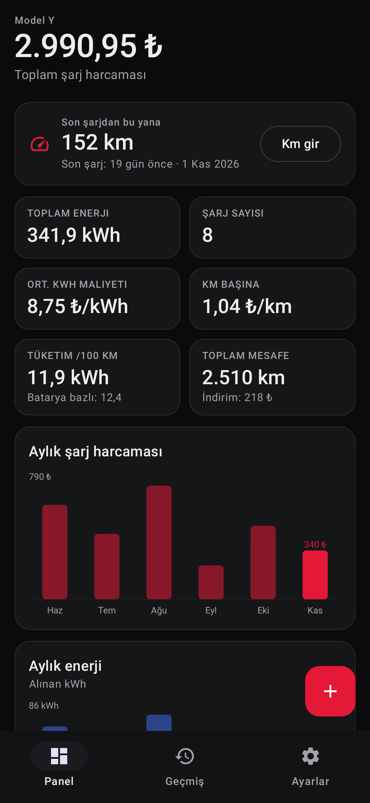
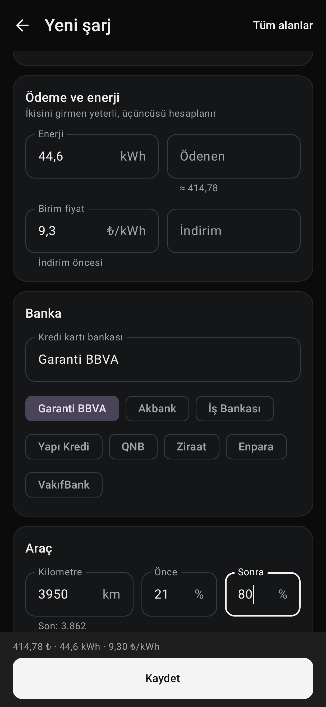
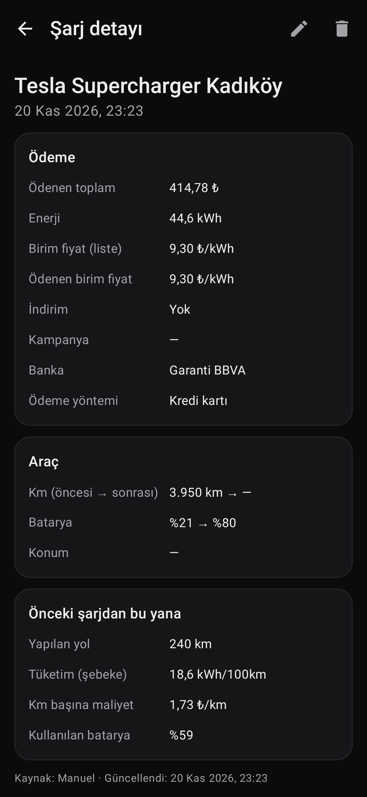
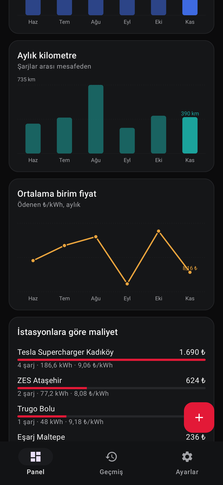
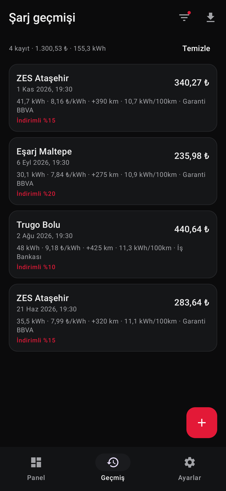
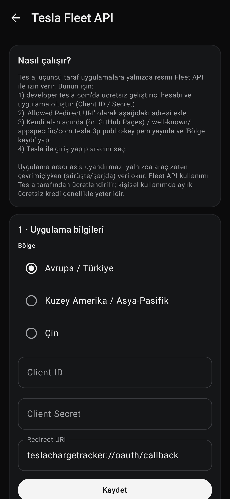

# Tesla Şarj Takip (Android)

Tesla Model Y Juniper için şarj geçmişini, maliyetleri, kilometre ve tüketimi takip eden **çevrimdışı öncelikli** Android uygulaması.
Kotlin + Jetpack Compose (Material 3), Room, WorkManager, DataStore. Harici sunucu, hesap veya analitik yoktur.

## Özellikler

| Alan | Durum |
|---|---|
| Manuel şarj kaydı (tarih, istasyon, konum, tutar, kWh, birim fiyat, indirim %/₺, kampanya, banka, ödeme yöntemi, km öncesi/sonrası, batarya öncesi/sonrası, notlar) | ✅ |
| Eksik alanları sonradan düzenleme, "eksik bilgi" etiketi ve hatırlatması | ✅ |
| Tutar / kWh / birim fiyat / indirimden ikisi girilince diğerlerinin hesaplanması | ✅ |
| Hızlı kayıt (istasyon & banka çipleri, istasyonun son birim fiyatı, son banka/ödeme yöntemi otomatik) | ✅ |
| İki şarj arası mesafe, kWh/100 km (şebeke ve batarya bazlı), km başına maliyet | ✅ |
| Kısa şarjlar / eksik kayıtlar için "hesaptan hariç tut" ve elle mesafe düzeltmesi | ✅ |
| Şarjlar arası km okuması ("Son şarjdan bu yana X km") | ✅ |
| Panel: toplam harcama, enerji, şarj sayısı, ort. ₺/kWh, son şarj, son şarjdan km, tüketim, ₺/km | ✅ |
| Grafikler: aylık harcama, aylık enerji, aylık km, istasyonlara göre maliyet, ortalama birim fiyat | ✅ |
| Geçmiş + filtreler (tarih, istasyon, banka, tutar aralığı, indirimli/indirimsiz) | ✅ |
| CSV (Türkçe Excel uyumlu) ve gerçek **.xlsx** dışa aktarma | ✅ |
| Bluetooth ile araca binme / araçtan ayrılma hatırlatmaları (tekrar engelleme ile) | ✅ |
| Tesla Fleet API: km, batarya, şarj durumu, eklenen enerji, şarj başlangıç/bitiş | ✅ (geliştirici hesabı gerekir) |
| Şarj bitince bildirimden önceden doldurulmuş hızlı kayıt | ✅ (API ile otomatik; API'siz "sonra hatırlat") |
| Navigasyon hedefi şarj istasyonuysa varış öncesi soru | ✅ (API ile, isteğe bağlı) |

## Mimari

```
core/   Saf Kotlin (JVM) – platformdan bağımsız iş mantığı, birim testli
  PriceCalculator    tutar/enerji/birim/indirim tamamlama
  UsageCalculator    şarjlar arası segmentler, tüketim, ₺/km
  StatsCalculator    toplamlar, aylık seriler, istasyon dağılımı
  RecordFilter       geçmiş filtreleri
  TeslaBleName       Tesla BLE yerel adı deseni (deneysel)
app/
  data/       Room (ChargeSessionEntity, OdometerReadingEntity), ChargeRepository, DataStore ayarları
  tesla/      Fleet API istemcisi, OAuth2 PKCE, Keystore ile şifreli SecureStore
  reminders/  Bluetooth alıcısı, ReminderEngine, WorkManager işçileri, bildirimler
  export/     CSV + XLSX yazıcı (bağımlılıksız)
  ui/         Compose ekranları: Panel, Geçmiş, Detay, Kayıt, Km, Ayarlar, Tesla
```
Bağımlılıklar `AppContainer` ile elle enjekte edilir (Hilt gerekmez); her katman ayrı paket/modüldür. Room şeması `app/schemas/` altına
dışa aktarılır, sonraki sürümlerde migration yazılabilir.

## Gerçekçi kısıtlar (araştırma sonucu)

### Bluetooth
* **Tesla uygulamasının telefon anahtarı (BLE) oturumuna başka bir uygulama erişemez.** Android, bir uygulamanın GATT bağlantısını diğerine açmaz.
  Bu yüzden "Tesla uygulaması anahtarı bağladı" olayı doğrudan **tespit edilemez**.
* Uygulanan yöntem: telefonun araçla **klasik Bluetooth (medya/telefon)** eşleşmesi. `ACTION_ACL_CONNECTED/DISCONNECTED` Android'in
  manifestte dinlemeye izin verdiği istisna yayınlardandır; uygulama kapalıyken de çalışır. Ayarlardan aracın eşleşmiş cihazı seçilir.
* Deneysel seçenek: Tesla araçları BLE'de `S` + SHA1(VIN)[0..8] + `C` biçiminde ad yayınlar. Sistem bu link için ACL olayı üretirse ad
  deseniyle eşleştirilir. Güvenilir değildir, varsayılan kapalıdır.
* İzin: Android 12+ `BLUETOOTH_CONNECT` ("Yakındaki cihazlar"). Konum izni **istenmez** (tarama yapılmaz).
* Bağlantı dalgalanmalarına karşı: birden fazla link takip edilir, ayrılma 3 dk sonra değerlendirilir; bağlanma bildirimi en fazla 3 saatte bir,
  ayrılma bildirimi 4 saatte bir, son 3 saatte km girildiyse hiç sorulmaz.

### Şarj algılama ve navigasyon
* Telefon tek başına aracın şarjda olduğunu **güvenilir şekilde bilemez**. API yoksa: araçtan ayrılınca "Şarj kaydı / 1 saat sonra hatırlat"
  bildirimi sunulur.
* Fleet API bağlıysa: ayrılmadan 3 dk sonra (araç hâlâ uyanıkken) `charging_state` okunur; şarj varsa "Şarj başladı" bildirimi ve
  10–30 dk aralıklarla (en fazla 60 sorgu) takip, bitince kWh/batarya/km önceden doldurulmuş "Şarj kaydını oluştur" bildirimi.
* Navigasyon hedefi (`drive_state.active_route_destination`) yalnızca Fleet API ve `vehicle_location` kapsamıyla okunabilir. Varsayılan kapalı;
  açılırsa yalnızca araç Bluetooth'a bağlıyken 10 dk'da bir sorgu (en fazla 18).
* Google Maps / Tesla navigasyonu Android'de başka uygulamalara açık değildir.

### Tesla Fleet API
* Üçüncü taraf erişim yalnızca resmi **Fleet API** ile: developer.tesla.com'da hesap + uygulama (Client ID/Secret), izinli Redirect URI
  (`sarjdefteri://oauth/callback`; tarayıcı dönmezse yönlendirme adresi yapıştırılabilir), kendi alan adında
  `/.well-known/appspecific/com.tesla.3p.public-key.pem` yayınlanması ve bölge kaydı (`partner_accounts`, uygulamada butonu var).
  Public key için: `openssl ecparam -name prime256v1 -genkey -noout -out private.pem && openssl ec -in private.pem -pubout -out public.pem`
  (yalnızca okuma yapıldığından private key uygulamada kullanılmaz). Türkiye için bölge **Avrupa** (`fleet-api.prd.eu.vn.cloud.tesla.com`).
* Kimlik doğrulama: OAuth 2.0 Authorization Code + **PKCE**, kapsamlar `openid offline_access vehicle_device_data vehicle_location`.
* Maliyet: Fleet API kullanıma göre ücretlendirilir (veri istekleri, uyandırma, komutlar ayrı fiyatlanır) ve hesap başına aylık bir ücretsiz
  kredi verir; güncel fiyatlar için developer.tesla.com'u kontrol edin. Bu uygulamanın olay tetikli sorgu sayısı kişisel kullanımda bu kredinin çok altında kalacak şekilde tasarlandı.
* **Araç asla uyandırılmaz**: `wake_up` çağrısı yoktur. Önce `/vehicles/{id}` (uyandırmaz) ile durum okunur; yalnızca `online` ise
  `vehicle_data` çağrılır. Uykudaysa işlem atlanır (408 de aynı şekilde ele alınır).
* Supercharger fatura geçmişi (`/dx/charging/history`) bu sürümde içe aktarılmıyor; sonraki adım olarak eklenebilir.

### Güvenlik ve gizlilik
* Tüm veriler cihazdaki Room veritabanında. İnternet izni yalnızca Tesla API için.
* Tesla access/refresh token ve client secret, **Android Keystore AES-256-GCM** anahtarıyla şifrelenip saklanır, yedeklemeye dahil edilmez.
* Kaynak kodda hiçbir anahtar/token yoktur; kullanıcı kendi Client ID/Secret'ını uygulama içinde girer.

## Derleme

Gereksinimler: JDK 17+, Android SDK (platform 35, build-tools 35).

```bash
./gradlew test               # core + Robolectric (Room, hatırlatmalar, uçtan uca UI) testleri
./gradlew assembleRelease    # app/build/outputs/apk/release/app-release.apk
```
Release APK yerel kurulum kolaylığı için debug anahtarıyla imzalanır; mağaza/uzun vadeli dağıtım için kendi keystore'unuzu `signingConfigs`'e ekleyin
(farklı anahtarla imzalı sürüm, mevcut kurulumun üzerine yüklenemez).

Kurulum: APK'yı telefona aktarıp açın ("Bilinmeyen kaynaklardan yükleme" izni gerekir). İlk açılışta bildirim izni istenir; Bluetooth izni
Ayarlar → Araç Bluetooth'u bölümünden verilir.

## Ekranlar

Görüntüler `AppFlowTest` uçtan uca testi sırasında gerçek veritabanı üzerinde alınır (`app/build/screenshots`).

| Panel | Hızlı kayıt | Detay |
|---|---|---|
|  |  |  |
| **Grafikler** | **Filtreli geçmiş** | **Tesla Fleet API** |
|  |  |  |
